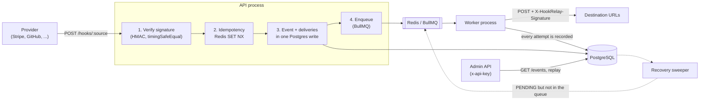
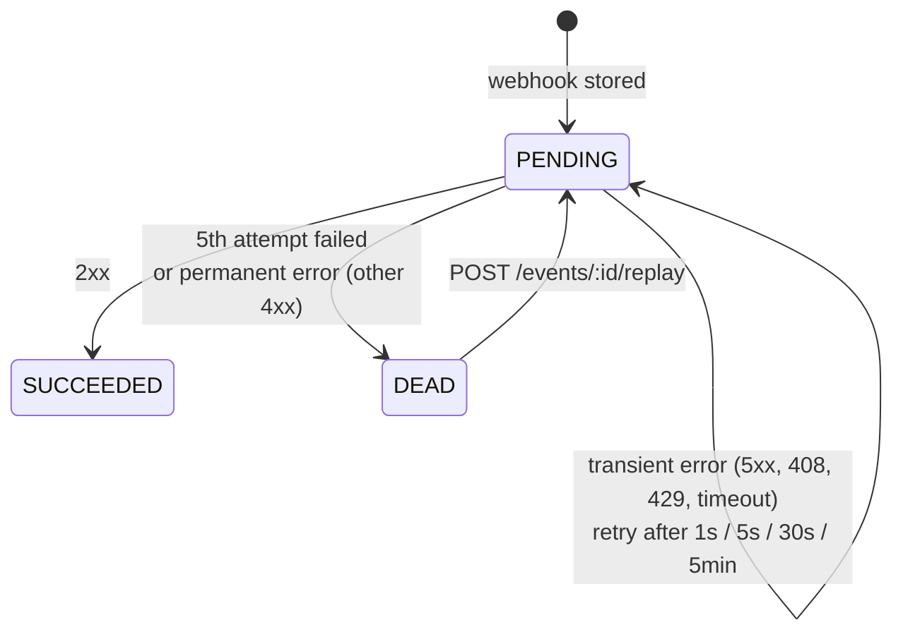

# HookRelay

[](https://github.com/atakannerturk/HookRelay/actions/workflows/ci.yml)

A service that receives webhooks from external providers (Stripe, GitHub, your own services), verifies their signatures, stores them durably and forwards them **reliably** to the destination URLs you configure. If a destination goes down, nothing is lost: deliveries are retried with growing delays, and if that fails they land in a dead-letter list from which they can be replayed by hand.

**Stack:** Node.js 24 · TypeScript · NestJS 11 · PostgreSQL 17 (Prisma 7) · Redis 7 · BullMQ · Docker Compose · Jest · GitHub Actions

## Features

- `POST /hooks/:source` receives a webhook, verifies its HMAC signature (GitHub, Stripe and a generic scheme), stores it in Postgres and answers **202** right away.
- A **queue and worker** (BullMQ) forward the event to the destination URLs. Failed deliveries are retried after **1s → 5s → 30s → 5min** (±10% jitter).
- **Dead-letter:** deliveries that fail all 5 attempts end up `failed`. Permanent errors (e.g. 400, 404) go there immediately instead of waiting.
- `POST /events/:id/replay` sends a failed event again with a fresh round of attempts.
- **Idempotency** (Redis + Postgres): when the same event arrives twice, the second copy is not processed. Even concurrent copies produce a single record.
- `GET /events?status=failed` lists events and their delivery state, with cursor pagination.
- **Fan-out:** a source can have several destinations, each with its own delivery and its own retries.
- **Outgoing signatures:** every request to a destination carries `X-HookRelay-Signature`, so the destination can verify it really came from HookRelay.
- **Recovery:** no webhook is lost even if Redis goes down for a while. Deliveries that never made it into the queue are re-enqueued in the background.
- The API and the worker run as **separate processes** and scale independently (`docker compose up --scale worker=3`).

## Architecture



**Core principle:** Postgres is the source of truth; the queue is only a scheduler. A webhook is accepted with 202 only after it has been written to Postgres. The attempt count, the last error and the next attempt time are kept in Postgres too, so the system can rebuild its state from Postgres even if the data in Redis is lost.

### Delivery lifecycle



An event's status is derived from its deliveries: `pending` (something is still in flight), `delivered` (all succeeded), `failed` (one is dead-lettered and nothing is in flight) or `skipped` (there was no active destination).

## Getting started

### With Docker (recommended)

```bash
docker compose up --build
```

This starts Postgres and Redis, applies the migrations and loads demo data (the `github`, `stripe` and `demo` sources). It then brings up the API (`:3000`), the worker and a sample destination server (`:4000`).

To send a signed test webhook (no Node.js needed on the host):

```bash
docker compose exec -e HOOKRELAY_URL=http://api:3000 receiver npx tsx scripts/send-webhook.ts github
docker compose logs -f worker receiver   # watch the delivery
```

To see retries and the dead-letter list in action, start the sample destination so that it rejects half of the requests:

```bash
RECEIVER_FAIL_RATE=0.5 docker compose up -d receiver
```

### Local development

```bash
cp .env.example .env
docker compose up -d postgres redis
npm install                          # postinstall: prisma generate
npm run db:migrate && npm run db:seed
npm run receiver                     # separate terminal: sample destination (:4000)
npm run dev                          # API + worker in one process (WORKER_ENABLED=true)
npm run send -- github               # send a signed webhook
npm run send -- demo 1 --duplicate   # same event twice -> 202, then 200 duplicate
```

> The Docker and local seeds write different destination addresses into the same database (`receiver:4000` vs `localhost:4000`). When switching between the two, reset the data with `docker compose down -v`.

## API

Admin endpoints require the `x-api-key: <ADMIN_API_KEY>` header (`dev-admin-key` in local development).

| Method | Path                 | Description                                                                                                                                   |
| ------ | -------------------- | --------------------------------------------------------------------------------------------------------------------------------------------- |
| POST   | `/hooks/:source`     | Receives a webhook. `202` accepted, `200` duplicate, `401` bad signature, `404` unknown source, `409` same event in progress, `413` too large |
| GET    | `/health`            | Postgres and Redis status (`200` / `503`)                                                                                                     |
| POST   | `/sources`           | Defines a source: `{ name, scheme: github \| stripe \| generic, secret }`                                                                     |
| GET    | `/sources`           | Lists sources (secrets are not returned)                                                                                                      |
| POST   | `/destinations`      | Defines a destination: `{ source, url, active? }`. The returned `secret` verifies outgoing signatures                                         |
| GET    | `/destinations`      | Lists destinations (`?source=`)                                                                                                               |
| PATCH  | `/destinations/:id`  | `{ url?, active? }`                                                                                                                           |
| GET    | `/events`            | `?status=pending\|delivered\|failed\|skipped&source=&limit=&cursor=`                                                                          |
| GET    | `/events/:id`        | Payload, headers and the history of every attempt                                                                                             |
| POST   | `/events/:id/replay` | Retries the dead-lettered deliveries (`202`; `409` if the event is not failed)                                                                |

```bash
# Dead-letter list
curl -H "x-api-key: dev-admin-key" "localhost:3000/events?status=failed"

# Send a failed event again
curl -X POST -H "x-api-key: dev-admin-key" localhost:3000/events/<id>/replay
```

<details>
<summary>Example <code>GET /events/:id</code> response (an event that was dead-lettered and then replayed, abridged)</summary>

```json
{
  "id": "fcbc4cae-e215-4e99-a861-7d1680f1260e",
  "source": "demo",
  "externalId": "5a0f…",
  "eventType": "order.created",
  "status": "delivered",
  "deliveries": [
    {
      "url": "http://receiver:4000/webhook",
      "status": "succeeded",
      "attempts": 1,
      "replayCount": 1,
      "attemptLog": [
        {
          "replayCount": 0,
          "number": 1,
          "statusCode": null,
          "error": "Network error: ECONNREFUSED"
        },
        {
          "replayCount": 0,
          "number": 5,
          "statusCode": null,
          "error": "Network error: ECONNREFUSED"
        },
        { "replayCount": 1, "number": 1, "statusCode": 200, "error": null }
      ]
    }
  ]
}
```

</details>

### Supported signature schemes

| Scheme    | Signature header                    | Signed data          | Event id                                            |
| --------- | ----------------------------------- | -------------------- | --------------------------------------------------- |
| `github`  | `X-Hub-Signature-256: sha256=<hex>` | raw body             | `X-GitHub-Delivery`                                 |
| `stripe`  | `Stripe-Signature: t=<ts>,v1=<hex>` | `` `${t}.${body}` `` | `id` in the body (5 min timestamp tolerance)        |
| `generic` | `X-Signature: sha256=<hex>`         | raw body             | `X-Event-Id`, `Idempotency-Key` or `id` in the body |

If none of these yields an event id, the SHA-256 hash of the body is used. Requests to destinations are signed with `X-HookRelay-Signature: t=<ts>,v1=HMAC(secret, "t.body")`; see [scripts/mock-receiver.ts](scripts/mock-receiver.ts) for a verification example.

## Design decisions

### What is the retry strategy?

- A fixed delay table: **1s, 5s, 30s, 5min** (`DELIVERY_RETRY_DELAYS_MS`) and **5 attempts** in total (`DELIVERY_MAX_ATTEMPTS`). A table is easier to reason about than pure exponential backoff and is close to what Stripe and GitHub do.
- **±10% jitter**, so that thousands of deliveries don't all hit a destination in the same millisecond when it comes back (thundering herd).
- **Error classification** ([retry-policy.ts](src/delivery/retry-policy.ts)): `5xx`, `408`, `429`, timeouts and network errors are transient and get retried. Any other `4xx`, and redirects, mean the destination is misconfigured; sending the same request again won't change the outcome, so the delivery goes straight to the dead-letter list.
- **The attempt counter lives in Postgres**, not in BullMQ. The processor computes the delay and carries it inside the thrown error to BullMQ's custom `backoffStrategy`, so the `nextAttemptAt` stored in the database matches the real delay in the queue exactly. The final attempt throws `UnrecoverableError` and BullMQ stops retrying ([delivery.worker.ts](src/delivery/delivery.worker.ts)).

### What happens when the same event arrives twice?

There are three layers of protection ([idempotency.service.ts](src/common/idempotency/idempotency.service.ts), [ingest.service.ts](src/ingest/ingest.service.ts)):

1. **Redis lock:** `SET idem:<source>:<eventId> processing NX EX 30`. A concurrent second copy gets **409**, and the provider retries later.
2. **Done marker:** once stored, the key becomes `done:<eventId>` (72 hours). Later copies get **200 duplicate** without touching the database.
3. **Postgres unique constraint** on `(source_id, external_id)`: no duplicate row can be created even if the Redis key expired or Redis was down.

If storing fails, the lock is deleted so that the provider's retry is not mistaken for a duplicate and lost. The e2e tests send the same webhook 10 times concurrently and check that exactly one event is created.

On the outgoing side the guarantee is **at-least-once**: if the destination returned 2xx but the response got lost on the way back, the event may be sent again. That is why every request carries `X-HookRelay-Event-Id`, which the destination can use to deduplicate on its side.

### What if a destination is down for hours?

- Nothing is lost: the event is in Postgres from the first moment. After 5 attempts (~5.6 min) the delivery becomes `dead` and shows up in `GET /events?status=failed`, together with the last error (`HTTP 503: …` or `ECONNREFUSED`) and the history of every attempt.
- Once the destination is back, `POST /events/:id/replay` starts a fresh round of 5 attempts. Destinations that already received the event successfully are not sent it again.
- Possible next steps: a per-destination circuit breaker (stop hammering a destination that keeps failing and keep the queue free for healthy ones), bulk replay, honoring the `Retry-After` header.

### What if Redis or Postgres goes down?

- **Redis down:** webhooks are still accepted with **202** because they are written to Postgres. Idempotency falls back to the unique constraint, and enqueueing gives up after a 2s timeout. When Redis comes back, the [recovery sweeper](src/delivery/delivery.recovery.ts) finds `PENDING` deliveries that have no job in the queue and enqueues them again. This scenario was tested by hand: with the Redis container stopped, a webhook still got 202 within ~2s and was delivered once Redis was started again. Recovery of a lost delivery is also covered by an e2e test.
- **Postgres down:** webhooks are not accepted (5xx). This is deliberate: we never say "received" for something we could not store. Stripe and GitHub retry non-2xx responses anyway.
- Job ids are deterministic (`<deliveryId>_<replayCount>`): recovery cannot enqueue the same delivery twice, while a replay gets a new job id.

### Concurrency

If two deliveries of the same event finish at the same time on different workers, both could compute the event's aggregate status from stale data and overwrite each other. To prevent this, the status update locks the event row with `SELECT … FOR UPDATE` inside a single transaction ([event-status.ts](src/events/event-status.ts)).

### Security

- Signatures are verified over the **raw bytes**: the JSON parser is disabled for `/hooks/*`, because parsing and re-serializing the body would break the signature ([http.ts](src/common/http.ts)).
- Comparisons are constant-time via `crypto.timingSafeEqual` (timing attacks). The Stripe scheme's timestamp tolerance stops captured requests from being replayed.
- Outgoing requests don't follow redirects (`redirect: manual`), which makes it harder to reach the internal network through a redirect (SSRF).
- Admin endpoints are protected with `x-api-key`. Source secrets are never returned by the API, and headers such as `authorization` and `cookie` are not stored.

### Scaling

The API only verifies, stores and enqueues; a separate worker process does the delivery. Under load, add worker replicas (`--scale worker=N`) and raise the per-worker concurrency (`WORKER_CONCURRENCY`). Redis runs with `noeviction` and AOF, so queue keys are never silently evicted when memory fills up and jobs survive a restart.

## Tests

```bash
npm test             # unit tests (59), no infrastructure needed
npm run test:cov     # + coverage report
npm run test:e2e     # e2e tests (20), needs docker compose up -d postgres redis
```

- **Unit:** signature verifiers (valid, wrong secret, tampered body, expired Stripe signature, secret rotation), retry policy and error classification, outgoing signatures, idempotency (including Redis being down), event status derivation, config validation. The ingest service's decision logic is covered too: duplicates, concurrent copies, falling back to Postgres without Redis, releasing the lock when storing fails.
- **E2E** (real Postgres, Redis, BullMQ worker and a programmable destination server): a GitHub webhook forwarded byte-for-byte with a verifiable outgoing signature; invalid signature; 413; idempotency (sequential, with the Redis key deleted, and 10 concurrent requests); fan-out; retry with `500 → 503 → 200`; dead-letter after 5 attempts; permanent 4xx; replay; recovery of a lost delivery; disabled destination; pagination.

The e2e tests use a separate database (`hookrelay_test`) and Redis DB (`/1`) so they never touch development data, and they apply the migrations themselves. In CI ([ci.yml](.github/workflows/ci.yml)) Postgres and Redis run as GitHub Actions services; the pipeline checks formatting, types, unit and e2e tests, the build and the Docker image.

## Load test

```bash
docker compose up -d --build
npm run loadtest                         # 50 connections, 20 s
CONNECTIONS=100 DURATION=30 npm run loadtest
```

[scripts/load-test.ts](scripts/load-test.ts) generates a unique event id and a valid signature for every request, so it measures the real path: signature check, Redis idempotency, Postgres write and enqueue. The worker keeps delivering at the same time.

**Result** (Docker Compose stack; API and worker in separate containers; autocannon running on the host):

| Metric             | Value       |
| ------------------ | ----------- |
| Connections / time | 50 / 20 s   |
| Total requests     | 3,582       |
| Requests/s (avg)   | 179         |
| Latency p50        | 256 ms      |
| Latency p97.5      | 468 ms      |
| Latency p99        | 497 ms      |
| Errors             | 0 (all 2xx) |

- When the load stopped, **every queued event was delivered within ~6 s** (3,632 / 3,632 `delivered`).
- **Bottleneck:** `docker stats` during the run showed API 130%, worker 107%, Postgres 112% and Redis 23% CPU. The API process is CPU-bound (a single Node event loop). Everything shared the same 4 physical cores, so these numbers are a lower bound. To scale further, add API replicas; the per-request source and destination lookups could also go into a short-TTL in-memory cache.
- Environment: Intel i7-7700HQ (4 cores / 8 threads), 16 GB RAM, Windows 10 + Docker Desktop (WSL2). A second 15 s run with the same settings gave 207 requests/s and a p99 of 346 ms.

## Project structure

```
hookrelay/
├── src/
│   ├── ingest/          # POST /hooks/:source, signature verifiers (github, stripe, generic)
│   ├── events/          # listing, details, replay, event status derivation + row lock
│   ├── delivery/        # BullMQ queue + worker, HTTP sender, retry policy, recovery
│   ├── destinations/    # destination URLs
│   ├── sources/         # webhook sources (name, signature scheme, secret)
│   ├── common/          # config (zod), logger, prisma, redis, idempotency, auth, health
│   ├── main.ts          # API process
│   └── worker.ts        # worker process (no HTTP server)
├── prisma/              # schema.prisma, migrations, seed
├── scripts/             # sample destination, signed webhook sender, load test
├── test/                # unit/ and e2e/
├── docker-compose.yml
└── Dockerfile
```

## Configuration

All variables and their defaults are in [.env.example](.env.example). They are validated with zod at startup; with a missing or invalid value the app refuses to start.

| Variable                   | Default                  | Description                                     |
| -------------------------- | ------------------------ | ----------------------------------------------- |
| `DATABASE_URL`             | (required)               | PostgreSQL connection                           |
| `REDIS_URL`                | `redis://localhost:6379` | Redis connection                                |
| `ADMIN_API_KEY`            | (required)               | `x-api-key` for the admin endpoints             |
| `WORKER_ENABLED`           | `true`                   | Whether this process also runs the worker       |
| `WORKER_CONCURRENCY`       | `10`                     | Concurrent deliveries per worker                |
| `DELIVERY_MAX_ATTEMPTS`    | `5`                      | Total attempts before dead-lettering            |
| `DELIVERY_RETRY_DELAYS_MS` | `1000,5000,30000,300000` | Waits between attempts                          |
| `DELIVERY_RETRY_JITTER`    | `0.1`                    | ± randomness ratio applied to each delay        |
| `DELIVERY_TIMEOUT_MS`      | `10000`                  | Timeout for requests to destinations            |
| `IDEMPOTENCY_TTL_SECONDS`  | `259200`                 | How long the "processed" marker stays (72 h)    |
| `RECOVERY_INTERVAL_MS`     | `30000`                  | How often the recovery sweeper runs             |
| `MAX_BODY_BYTES`           | `1048576`                | Largest accepted webhook body                   |
| `LOG_JSON`                 | `false`                  | One JSON object per log line (`true` in Docker) |

## Known limitations and roadmap

- Payloads are stored as UTF-8 text; binary webhook bodies are not supported.
- Secrets are stored in plain text in the database. Production would need a KMS or application-level encryption.
- No per-destination circuit breaker, rate limiting, bulk replay or `Retry-After` support yet.
- Destination URLs are set by an admin; requests to private IP ranges are not blocked separately.
- A retention job for old events, metrics (Prometheus) and tracing could be added.
- The Prisma 7 client loads its query compiler with a dynamic `import()`, so the e2e tests run with `node --experimental-vm-modules` (`npm run test:e2e` does this for you).
